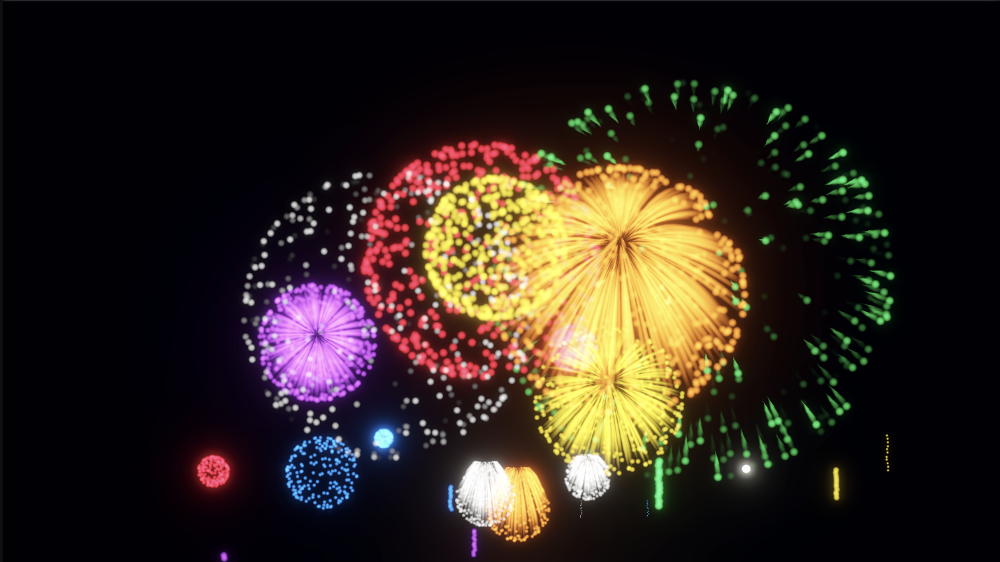
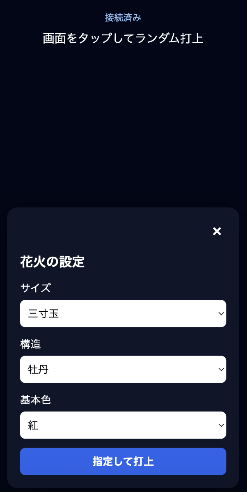

# Fireworks

花火を楽しむための、Unity製花火シミュレーションです。PCの大きな画面に花火を表示し、PC・スマートフォン・タブレットから打ち上げられます。

Codexの使い方を勉強するために作ったプロジェクトで、ほぼCodexのみで作っています。

## 実行時イメージ

| PC表示 | スマートフォン操作 |
|---|---|
|  |  |
| 花火シミュレーション画面 | LAN経由の操作画面 |

## 主な機能

- 牡丹、菊、変化菊、冠、文字花火
- 玉のサイズに応じた開花直径、粒子数、打上高度、効果音
- Bloomを使った発光表現と、任意の打上音・破裂音
- 最大6文字を発光粒子で描く文字花火
- PC上のuGUIデバッグUIによるパラメーター指定
- 同一LAN上のスマートフォン／タブレットからのHTTP操作
- 待機時にPC画面へLAN操作用QRコードを表示

## 動作環境

- Unity 6000.5.6f1
- Universal Render Pipeline（URP）
- PC向けスタンドアロンビルド

## 起動方法

1. Unity Hubでこのプロジェクトを開きます。
2. `Assets/Scenes/MainScene.unity` を開きます。
3. Playモードで実行するか、PC向けにビルドして起動します。

## 操作方法

|操作|内容|
|---|---|
|Space|ランダムな花火を打ち上げる|
|画面クリック|ランダムな花火を打ち上げる（UI上のクリックを除く）|
|Slash|PCのパラメーターUIを表示／非表示|
|Escape|アプリ情報パネルを表示／非表示。ライセンス表示中はライセンスパネルのみ閉じる|

パラメーターUIは初期状態で非表示です。表示中はマウスカーソルを表示し、非表示中は隠します。サイズ・構造・基本色を指定でき、変化菊では変化色も選択できます。文字花火を選択した場合だけ、最大6文字の文字入力欄が表示されます。

Escapeで開くアプリ情報パネルでは、アプリバージョンの確認、サードパーティーライセンスの表示、アプリ終了ができます。SlashとEscapeのキーは、MainSceneの `FireworkDebugUI` のInspectorから変更できます。

## スマートフォン・タブレット操作

アプリ実行中、花火が再生されていないときはPC画面右下にQRコードが表示されます。スマートフォンのカメラで読み取ると、同一LAN内の操作画面を開けます。花火を打ち上げるとQRコードは消え、すべての花火が終わってから約3秒後に再表示されます。

- 設定画面を閉じた状態で画面をタップ: ブラウザが全種類・サイズ・基本色を等確率で選ぶランダム打上
- 右下の歯車: 設定画面の表示／非表示を切り替える
- 設定画面: サイズ・構造・基本色を指定して打ち上げる。変化菊では変化色も指定できる
- 文字花火を選択: 最大6文字を入力して打ち上げる。未入力の場合、ランダム打上では英大文字1文字を表示する
- タップの受付時: 選ばれたサイズ・基本色に応じた波紋をタップ地点に表示

ページの拡大・縮小、通常テキストの選択、画面全体のスクロールは無効です。HTTPサーバーの既定ポートは `8080` です。PCのファイアウォールでローカルネットワークからの受信を許可してください。外部公開やルーターのポート転送は想定していません。

## プロジェクト構成

- `Assets/Prefabs/Types`: 花火種類ごとのPrefab
- `Assets/ScriptableObjects/FireworkSettings.asset`: サイズ・種類・色などの設定
- `Assets/StreamingAssets/WebController`: スマートフォン操作用Web画面
- `docs`: 仕様・設計資料

新しい花火は既存の種類Prefabを複製し、`FireworkTypeDefinition` を設定して `FireworkSettings` の `Effects` に追加します。詳細は [花火仕様](docs/fireworks.md) を参照してください。

## ドキュメント

- [プロダクト方針](docs/vision.md)
- [花火仕様](docs/fireworks.md)
- [UI仕様](docs/ui.md)
- [LAN操作機能設計](docs/network.md)
- [アーキテクチャ](docs/architecture.md)

## サードパーティーライセンス

[第三者ライセンス一覧](ThirdPartyNotices.md) を参照してください。

## 効果音の追加

MainSceneの `Firework System` にある `FireworkAudio` コンポーネントの `Launch Clip` と `Explosion Clip` へ、打上音と破裂音をそれぞれ割り当ててください。詳細は[花火仕様の効果音](docs/fireworks.md#効果音)を参照してください。
